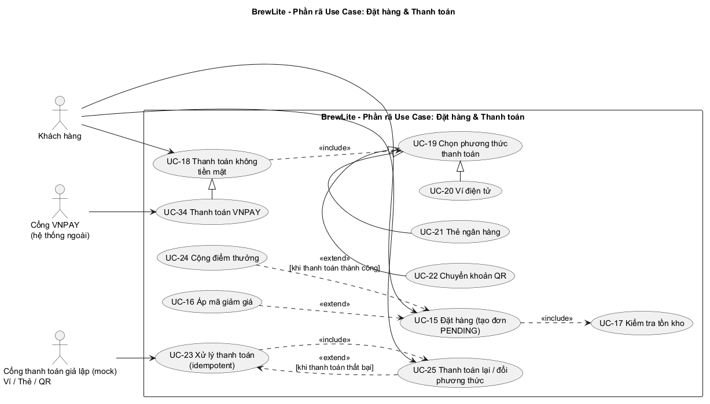

1. Mục đích và phạm vi
Tài liệu mô tả yêu cầu chức năng, phi chức năng và tiêu chí chấp nhận của BrewLite. BrewLite hỗ trợ khách hàng xem menu, tùy chỉnh đồ uống, quản lý giỏ hàng, đăng ký/đăng nhập, đặt hàng, thanh toán không tiền mặt và xem lịch sử đơn.
Frontend sử dụng Next.js; backend sử dụng NestJS; dữ liệu được lưu trong PostgreSQL. Thanh toán trong phạm vi bài tập lớn được mô phỏng qua dịch vụ thanh toán Ví/Thẻ.
2. Quy ước ưu tiên MoSCoW
-Must: bắt buộc để MVP thực hiện được luồng nghiệp vụ cốt lõi.
-Should: quan trọng, nên hoàn thành; có thể được ưu tiên sau nhóm Must.
-Could: có giá trị bổ sung nhưng không ảnh hưởng đến luồng MVP tối thiểu.
-Won't (this release): không thực hiện trong phiên bản MVP hiện tại.
Mức ưu tiên dưới đây là đề xuất phân loại để đáp ứng yêu cầu Assignment 2; nội dung chức năng và mã yêu cầu được kế thừa từ tài liệu yêu cầu BrewLite của nhóm.
3. Yêu cầu chức năng (Functional Requirements)
3.1. Menu
| Mã | Tên yêu cầu | Yêu cầu | Ưu tiên |
| :---: | :--- | :--- | :---: |
| FR-01 | Hiển thị menu | Hệ thống cho phép khách hàng xem danh sách đồ uống đang kinh doanh, kèm hình, tên và giá. | Must |
| FR-02 | Thông tin sản phẩm | Mỗi sản phẩm có tên, hình ảnh (nếu có), mô tả, giá cơ bản và trạng thái còn/hết hàng. | Must |
| FR-03 | Lọc theo danh mục | Khách hàng xem đồ uống theo danh mục như cà phê, trà hoặc nhóm khác. | Should |
| FR-04 | Trạng thái hiển thị | Chỉ sản phẩm đang kinh doanh và còn hàng mới được đặt. | Must |

Acceptance Criteria
AC-01.1: Khi khách truy cập trang menu, hệ thống hiển thị danh sách đồ uống đang kinh doanh.
AC-01.2: Mỗi sản phẩm hiển thị hình, tên, giá cơ bản và trạng thái còn/hết hàng.
AC-01.3: Khi chọn danh mục, hệ thống chỉ hiển thị sản phẩm thuộc danh mục đó.
AC-01.4: Khi chọn sản phẩm, khách mở được trang chi tiết.
AC-01.5: Sản phẩm hết hàng không được thêm vào giỏ để đặt mua.
AC-01.6: Khi dữ liệu đang tải hoặc danh sách rỗng, giao diện hiển thị trạng thái loading hoặc thông báo rỗng.
3.2. Chi tiết, size, topping
| Mã | Tên yêu cầu | Yêu cầu | Ưu tiên |
| :---: | :--- | :--- | :---: |
| FR-05 | Chi tiết đồ uống | Khách hàng xem thông tin chi tiết đồ uống trước khi chọn. | Must |
| FR-06 | Chọn size | Khách chọn size S, M hoặc L; giá cập nhật theo size. | Must |
| FR-07 | Chọn topping | Khách chọn topping được hỗ trợ; giá topping được cộng vào giá sản phẩm. | Must |
| FR-08 | Số lượng | Khách chọn số lượng đồ uống. | Must |
| FR-09 | Tính giá | Thành tiền = (Giá cơ bản + Phụ thu size + Tổng giá topping) × Số lượng. | Must |

Acceptance Criteria
AC-02.1: Trang chi tiết hiển thị các size (S, M, L) và topping được hỗ trợ.
AC-02.2: Khi chọn size, hệ thống cập nhật phụ thu và giá sản phẩm.
AC-02.3: Khi chọn hoặc bỏ chọn topping, tổng giá được cập nhật.
AC-02.4: Hệ thống không cho xác nhận nếu thiếu tùy chọn bắt buộc (size).
AC-02.5: Khi thêm vào giỏ, hệ thống lưu đúng size, topping, số lượng và giá đã tính.
3.3. Giỏ hàng
| Mã | Tên yêu cầu | Yêu cầu | Ưu tiên |
| :---: | :--- | :--- | :---: |
| FR-10 | Thêm sản phẩm | Khách thêm đồ uống đã chọn vào giỏ. | Must |
| FR-11 | Cập nhật giỏ | Khách thay đổi số lượng hoặc chỉnh sửa size, topping trong giỏ. | Must |
| FR-12 | Xóa sản phẩm | Khách xóa sản phẩm khỏi giỏ. | Must |
| FR-13 | Tính tổng tiền | Hệ thống tự cập nhật tổng tiền khi giỏ hàng thay đổi. | Must |
| FR-14 | Kiểm tra trước khi đặt | Trước khi đặt, hệ thống kiểm tra sản phẩm còn kinh doanh, số lượng và giá hiện tại. | Must |
Acceptance Criteria
AC-03.1: Khi thêm sản phẩm hợp lệ, sản phẩm xuất hiện trong giỏ và số lượng trên biểu tượng giỏ hàng được cập nhật.
AC-03.2: Khi đổi số lượng, hệ thống cập nhật thành tiền và tổng tiền.
AC-03.3: Khi xóa sản phẩm, hệ thống loại bỏ sản phẩm và tính lại tổng.
AC-03.4: Không cho phép số lượng nhỏ hơn 1 đối với sản phẩm còn trong giỏ.
AC-03.5: Giỏ trống hiển thị thông báo và không cho tiến hành thanh toán. Khi giỏ có ít nhất 1 sản phẩm, nút “Thanh toán” hiển thị tổng tiền.
AC-03.6: Trước khi tạo đơn, hệ thống kiểm tra lại giá và tình trạng sản phẩm.
3.4. Đăng ký, đăng nhập
| Mã | Tên yêu cầu | Yêu cầu | Ưu tiên |
| :---: | :--- | :--- | :---: |
| FR-15 | Đăng ký | Người dùng đăng ký bằng email, tên đăng nhập, mật khẩu, họ tên; số điện thoại không bắt buộc. | Must |
| FR-16 | Đăng nhập | Người dùng đăng nhập bằng thông tin tài khoản hợp lệ. | Must |
| FR-17 | Kiểm tra xác thực | Hệ thống từ chối thông tin đăng nhập sai và hiển thị thông báo phù hợp. | Must |
| FR-18 | Quản lý phiên (JWT) | Hệ thống cấp và kiểm tra token JWT cho các chức năng cần đăng nhập. | Must |
| FR-19 | Bảo vệ dữ liệu cá nhân | Khách hàng chỉ xem lịch sử đơn hàng thuộc tài khoản của mình. | Must |
Acceptance Criteria
AC-04.1: Đăng ký với thông tin hợp lệ thì tài khoản được tạo thành công.
AC-04.2: Thông tin đăng ký thiếu, sai định dạng hoặc email/tên đăng nhập đã tồn tại thì hệ thống báo lỗi phù hợp.
AC-04.3: Nhập đúng thông tin đăng nhập thì người dùng nhận được token và truy cập được chức năng cần xác thực.
AC-04.4: Nhập sai thông tin thì hệ thống từ chối truy cập và không tiết lộ mật khẩu đúng.
AC-04.5: Mật khẩu trong cơ sở dữ liệu ở dạng băm, không phải văn bản thuần.
AC-04.6: Token hết hạn hoặc không hợp lệ thì yêu cầu cần xác thực bị từ chối.
3.5. Tạo đơn, thanh toán
| Mã | Tên yêu cầu | Yêu cầu | Ưu tiên |
| :---: | :--- | :--- | :---: |
| FR-20 | Tạo đơn hàng | Khách xác nhận giỏ hàng để tạo đơn ở trạng thái PENDING. | Must |
| FR-21 | Tính tổng đơn | Hệ thống tính tổng từ giá sản phẩm, size, topping, số lượng và trừ giảm giá nếu có. | Must |
| FR-22 | Phương thức thanh toán | Hệ thống cung cấp hai phương thức không tiền mặt là Ví điện tử và Thẻ ngân hàng qua dịch vụ thanh toán giả lập. | Must |
| FR-23 | Ghi nhận kết quả | Hệ thống ghi nhận giao dịch thành công hoặc thất bại dựa trên phản hồi của dịch vụ thanh toán. | Must |
| FR-24 | Cập nhật trạng thái | Thanh toán thành công thì đơn chuyển PAID; thất bại thì chuyển PAYMENT_FAILED và giỏ hàng được giữ nguyên để thử lại. | Must |
| FR-25 | Chống giao dịch trùng | Hệ thống chống thanh toán trùng bằng Idempotency-Key; gửi lặp cùng yêu cầu không tạo thêm giao dịch hay thu tiền hai lần. | Must |

Acceptance Criteria
AC-05.1: Khi giỏ hàng có ít nhất 1 sản phẩm hợp lệ và khách chọn thanh toán, hệ thống cho chuyển sang bước thanh toán. Nếu chưa đăng nhập, chuyển sang màn hình đăng nhập.
AC-05.2: Hệ thống kiểm tra sản phẩm, size, topping, số lượng và tính lại tổng tiền trước khi tạo đơn.
AC-05.3: Khi dữ liệu hợp lệ, hệ thống tạo mã đơn duy nhất, lưu chi tiết sản phẩm, đặt đơn ở trạng thái PENDING và hiển thị tổng tiền cần thanh toán.
AC-05.4: Khách chọn Ví hoặc Thẻ rồi xác nhận; nếu thành công, hệ thống ghi nhận giao dịch và đơn chuyển PAID.
AC-05.5: Nếu thanh toán thất bại, hệ thống thông báo lỗi, đơn chuyển PAYMENT_FAILED, giỏ hàng được giữ nguyên và khách có thể thử lại.
AC-05.6: Khi cùng một yêu cầu thanh toán (cùng Idempotency-Key) được gửi lại nhiều lần, hệ thống chỉ ghi nhận một giao dịch.
AC-05.7: Sau khi thanh toán thành công, hiển thị mã đơn, danh sách đồ uống, tổng tiền và trạng thái PAID.
AC-05.8: Số tiền thanh toán được ghi nhận khớp số tiền hệ thống tính cho đơn.
3.6. Xác nhận, lịch sử đơn
| Mã | Tên yêu cầu | Yêu cầu | Ưu tiên |
| :---: | :--- | :--- | :---: |
| FR-26 | Xác nhận đơn | Hệ thống hiển thị mã đơn, danh sách sản phẩm, tổng tiền và trạng thái. | Must |
| FR-27 | Trạng thái xử lý | Hệ thống hỗ trợ hiển thị các trạng thái PENDING, PAYMENT_FAILED, PAID, PREPARING, READY, COMPLETED, CANCELLED. | Must |
| FR-28 | Lịch sử đơn | Khách đã đăng nhập xem danh sách đơn hàng trước đây của mình. | Must |
| FR-29 | Chi tiết đơn | Khách xem sản phẩm, size, topping, số lượng, tổng tiền, thời gian và trạng thái của đơn. | Must |
| FR-30 | Điều kiện xử lý đơn | Chỉ đơn PAID mới đủ điều kiện chuyển sang PREPARING; thao tác pha chế của barista nằm ngoài MVP. | Must |
Acceptance Criteria
AC-06.1: Hệ thống hiển thị danh sách đơn thuộc tài khoản đang đăng nhập.
AC-06.2: Mỗi đơn hiển thị mã đơn, thời gian đặt, tổng tiền và trạng thái.
AC-06.3: Khi chọn đơn, hiển thị đồ uống, size, topping, số lượng và thông tin thanh toán.
AC-06.4: Nếu chưa có đơn hàng, hệ thống hiển thị thông báo phù hợp.
AC-06.5: Người dùng không thể xem đơn của tài khoản khác bằng cách đổi mã đơn trên URL hoặc API.
AC-06.6: Trạng thái hiển thị phản ánh dữ liệu lưu trong hệ thống; tạo đơn không đồng nghĩa với đã thanh toán.
3.7. Nghiệp vụ nâng cao (Task 10)
| Mã | Tên yêu cầu | Yêu cầu | Ưu tiên |
| :---: | :--- | :--- | :---: |
| FR-31 | Trạng thái đơn hàng | Đơn hàng chỉ chuyển trạng thái theo các chuyển tiếp hợp lệ; chuyển tiếp sai bị từ chối. | Should |
| FR-32 | Kiểm soát tồn kho | Khi nhiều khách đặt cùng lúc, hệ thống không bán vượt số lượng còn lại; tồn kho không âm. | Should |
| FR-33 | Mã giảm giá | Khách nhập mã hợp lệ (còn hạn, còn lượt dùng, đủ giá trị đơn tối thiểu) để được giảm tổng tiền. | Could |
| FR-34 | Điểm thưởng | Khách được cộng điểm khi đơn chuyển PAID (1 điểm/10.000đ, làm tròn xuống), chỉ cộng một lần mỗi đơn. | Could |
| FR-35 | Hủy đơn | Khi đơn bị hủy từ PAID, PREPARING hoặc PAYMENT_FAILED, hệ thống hoàn lại tồn kho, trừ điểm đã cộng và hoàn lượt dùng mã. | Could |
Acceptance Criteria
AC-07.1: Khi nhập mã hợp lệ, tổng tiền của đơn được giảm đúng giá trị.
AC-07.2: Mã sai, hết hạn, hết lượt dùng hoặc đơn chưa đạt giá trị tối thiểu thì bị từ chối kèm thông báo.
AC-07.3: Sau khi đơn chuyển PAID, điểm thưởng của khách tăng đúng một lần theo quy tắc 1 điểm cho mỗi 10.000đ.
AC-07.4: Thanh toán gửi lại cùng Idempotency-Key không làm cộng điểm thêm.
AC-07.5: Khi đơn bị hủy, điểm đã cộng bị trừ lại và lượt dùng mã được hoàn.
4. Yêu cầu phi chức năng (Non-Functional Requirements)
| Mã | Yêu cầu | Ưu tiên | Tiêu chí kiểm chứng |
| :---: | :--- | :---: | :--- |
| NFR-01 | API thông thường phản hồi dưới 500 ms với dữ liệu mẫu trong môi trường kiểm thử đã xác định. Không tính thời gian chờ dịch vụ thanh toán ngoài. | Should | Ghi rõ môi trường, số yêu cầu đồng thời và cách đo; đo từ lúc server nhận request đến lúc trả response. |
| NFR-02 | Không lưu mật khẩu dạng văn bản thuần; dùng bcrypt hoặc Argon2id với salt theo thư viện; không ghi thông tin xác thực nhạy cảm vào log. | Must | Kiểm tra dữ liệu lưu trong DB là hash; rà soát log không có mật khẩu. |
| NFR-03 | API cần đăng nhập phải kiểm tra JWT hợp lệ; người dùng chỉ truy cập dữ liệu thuộc quyền của mình. | Must | Request thiếu/sai/hết hạn JWT bị từ chối; thử truy cập đơn người khác bị từ chối. |
| NFR-04 | Server kiểm tra trường bắt buộc, kiểu dữ liệu, số lượng, size, topping; tự tính lại giá; dùng ORM/truy vấn tham số hóa. | Must | Gửi dữ liệu thiếu/sai hoặc sửa giá từ client; server từ chối hoặc tính lại giá đúng. |
| NFR-05 | Chỉ ghi nhận thanh toán thành công dựa trên kết quả server nhận từ dịch vụ thanh toán; số tiền lấy từ đơn; cùng Idempotency-Key không ghi nhận nhiều lần. | Must | Kiểm thử kết quả thành công/thất bại và gửi lặp cùng khóa; chỉ có một kết quả giao dịch được ghi nhận. |
| NFR-06 | Dùng HTTPS khi triển khai thực tế; không đưa khóa bí mật/thông tin xác thực thanh toán vào mã nguồn trình duyệt. | Must | Kiểm tra URL triển khai và rà soát mã frontend/repository. |
| NFR-07 | Hỗ trợ phiên bản ổn định hiện hành của Chrome, Edge, Firefox tại thời điểm nghiệm thu; giao diện dùng được trên máy tính và điện thoại. | Should | Kiểm thử menu, giỏ hàng, đăng nhập, thanh toán và lịch sử trên trình duyệt mục tiêu, ở kích thước desktop/mobile. |
| NFR-08 | Nút thao tác, thông báo lỗi rõ ràng; khách thấy tổng tiền và phương thức thanh toán trước khi xác nhận; có loading và lỗi cơ bản. | Should | Kiểm thử các trạng thái loading, empty, error và nội dung xác nhận trước thanh toán. |
| NFR-09 | Đơn hàng, chi tiết sản phẩm và giao dịch được lưu nhất quán bằng transaction; tạo đơn thất bại không để lại dữ liệu đơn không hợp lệ; tổng tiền khớp chi tiết và thanh toán. | Must | Kiểm thử tình huống lỗi giữa quy trình; kiểm tra dữ liệu sau rollback và đối chiếu tổng tiền. |
| NFR-10* | Hệ thống cần có khả năng phục vụ các chức năng cốt lõi khi người dùng truy cập; khi có lỗi, giao diện hiển thị thông báo phù hợp thay vì dừng không phản hồi. | Should | Kiểm thử các luồng menu, giỏ hàng, đăng nhập và đặt hàng; kiểm tra trạng thái lỗi và khả năng thao tác lại. |
| NFR-11* | Hệ thống cần có hướng dẫn cấu hình và triển khai có thể lặp lại; cấu hình môi trường và secret được tách khỏi mã nguồn. | Must | Một thành viên khác có thể làm theo README và .env.example để chạy local bằng Docker; rà soát repository không chứa secret thật. |
5. Quy tắc nghiệp vụ (Business Rules)
-BR-01: Chỉ sản phẩm đang kinh doanh và còn hàng mới được đặt.
-BR-02: Máy chủ tính lại tổng tiền, không phụ thuộc giá do giao diện gửi lên.
-BR-03: Mỗi đơn hàng có mã duy nhất để tra cứu.
-BR-04: Chỉ xác định đã thanh toán khi dịch vụ thanh toán trả kết quả thành công.
-BR-05: Phân biệt trạng thái đơn hàng và trạng thái thanh toán; đơn đã thanh toán vẫn có thể đang pha chế.
-BR-06: Khách hàng chỉ truy cập dữ liệu và đơn hàng thuộc quyền của mình.
-BR-07: Thanh toán gửi lại cùng Idempotency-Key không gây ghi nhận trùng hoặc thu tiền hai lần cho cùng đơn.
-BR-08: Đơn hàng chỉ chuyển trạng thái theo máy trạng thái: PENDING → PAID → PREPARING → READY → COMPLETED; PENDING → PAYMENT_FAILED → PENDING; được hủy từ PAID, PREPARING, PAYMENT_FAILED. COMPLETED và CANCELLED là trạng thái kết thúc.
-BR-09: Tồn kho được trừ khi tạo đơn và hoàn lại khi đơn bị hủy.
-BR-10: Mã giảm giá chỉ hợp lệ khi còn hạn, còn lượt dùng và đơn đạt giá trị tối thiểu; mỗi đơn dùng tối đa một mã.
-BR-11: Điểm thưởng bằng 1 điểm cho mỗi 10.000đ của tổng tiền phải trả (làm tròn xuống), chỉ cộng một lần cho mỗi đơn khi đơn chuyển PAID.
6. Use Case tổng quát
Các actor và use case chính được mô tả trong biểu đồ use case tổng quát. Khách hàng là actor chính thực hiện các thao tác từ xem menu, quản lý giỏ hàng đến đặt hàng và theo dõi đơn. Hệ thống tương tác với các actor phụ gồm: Cổng thanh toán giả lập (Ví/Thẻ/QR) và Cổng VNPay để xử lý giao dịch; Scheduler để thực hiện các tác vụ tự động (như tự động hủy đơn PENDING quá hạn). Barista đã được loại bỏ khỏi biểu đồ tổng thể vì không nằm trong MVP.
7. Truy vết yêu cầu
| Nhóm yêu cầu | User Story | Use Case | API/Thành phần dự kiến | Kiểm thử gợi ý |
| :---: | :--- | :--- | :--- | :--- |
| FR-01–FR-03 | US-01 Xem menu | UC-01 Xem menu đồ uống | GET /products, GET /categories (nếu có) | Kiểm tra danh sách, lọc danh mục, sản phẩm hết hàng |
| FR-04–FR-09 | US-02 Chọn size và topping | UC-02, UC-04, UC-05, UC-06 | API chi tiết sản phẩm | Kiểm tra giá theo size/topping/số lượng |
| FR-10–FR-14 | US-03 Quản lý giỏ hàng | UC-07, UC-08, UC-09 | Frontend cart; API kiểm tra lại khi đặt | Thêm/sửa/xóa, tính tổng, kiểm tra giá |
| FR-15–FR-19 | US-04 Đăng ký và đăng nhập | UC-10, UC-11, UC-12, UC-13, UC-14 | API auth/JWT | Đăng ký hợp lệ, đăng nhập sai, token hết hạn |
| FR-20–FR-25 | US-05 Tạo đơn và thanh toán | UC-15, UC-17, UC-18 đến UC-23, UC-25, UC-32 | API orders/payments | Tạo đơn, thanh toán thành công/thất bại, idempotency |
| FR-26–FR-30 | US-06 Xem lịch sử đơn | UC-26, UC-27, UC-28, UC-30 | API orders/history | Xem lịch sử, chi tiết, phân quyền |
| FR-31–FR-35 | US-07 Mã giảm giá và điểm thưởng | UC-16 Áp mã, UC-24 Cộng điểm, UC-29 Hủy đơn, UC-31 Tự động hủy đơn | Nghiệp vụ nâng cao | Trạng thái, tồn kho, voucher, điểm, hủy đơn |

Lưu ý: Tên endpoint trong bảng truy vết là gợi ý ở mức phân tích; cần đối chiếu với API thực tế của repository trước khi chốt tài liệu.
8. Kết luận
SRS rút gọn cung cấp các yêu cầu có mã định danh, mức ưu tiên, tiêu chí chấp nhận và quy tắc nghiệp vụ để làm cơ sở cho thiết kế, lập trình và kiểm thử. Các yêu cầu nghiệp vụ nâng cao được phân biệt với phạm vi MVP để tránh hiểu nhầm rằng mọi chức năng đều bắt buộc có trong phiên bản đầu tiên.

Task 1.3 – Đặc tả Use Case UC-15 & UC-18: Đặt hàng (tạo đơn) và Thanh toán không tiền mặt

| Thuộc tính | Chi tiết đặc tả |
| :--- | :--- |
| **Mã Use Case** | UC-15, UC-18 |
| **Tên Use Case** | Đặt hàng (tạo đơn) và Thanh toán không tiền mặt |
| **Phạm vi / Mức độ** | Hệ thống BrewLite / Mục tiêu người dùng |
| **Actor chính** | Khách hàng |
| **Actor phụ** | Cổng thanh toán giả lập (Ví/Thẻ/QR), Cổng VNPay, Scheduler |
| **Mục tiêu / Mô tả** | Khách hàng đã chọn đồ uống trong giỏ. Hệ thống kiểm tra hợp lệ, tạo đơn (PENDING). Khách chọn phương thức thanh toán trực tuyến. Nhận kết quả thành công thì chuyển PAID, thất bại chuyển PAYMENT_FAILED. |
| **Trigger** | Khách hàng nhấn nút Thanh toán/Đặt hàng tại giỏ hàng. |
| **Tiền điều kiện** | 1. Khách hàng đã đăng nhập (nếu chưa sẽ được yêu cầu đăng nhập). 2. Giỏ hàng có ít nhất một sản phẩm hợp lệ, còn hàng. 3. Hệ thống thanh toán giả lập/VNPay đang hoạt động. |
| **Hậu điều kiện** | - **Thành công:** Đơn hàng được tạo, lưu DB nhất quán, thanh toán ghi nhận thành công, trạng thái PAID. - **Thất bại:** Nếu dữ liệu sai, không tạo đơn. Nếu thanh toán lỗi, đơn chuyển PAYMENT_FAILED, giữ giỏ hàng để khách thử lại. |
| **Luồng chính (Main Flow)** | 1. Khách hàng kiểm tra giỏ hàng và nhấn Đặt hàng. 2. Hệ thống kiểm tra trạng thái đăng nhập/JWT. 3. Hệ thống kiểm tra sản phẩm, số lượng, tồn kho, tính lại tổng tiền từ server. 4. Tạo đơn hàng (PENDING) và chi tiết đơn trong transaction. 5. Hệ thống hiển thị các phương thức thanh toán (Ví/Thẻ/VNPay). 6. Khách hàng chọn phương thức và xác nhận. 7. Hệ thống tạo yêu cầu thanh toán (gửi kèm Idempotency-Key). 8. Cổng thanh toán xử lý và trả kết quả thành công. 9. Hệ thống cập nhật giao dịch, chuyển đơn sang PAID. 10. Hiển thị xác nhận đơn hàng thành công cho khách. |
| **Luồng thay thế (Alternative)** | - **A1 (Tại bước 2):** Nếu chưa đăng nhập, yêu cầu đăng nhập -> thành công thì quay lại bước 1. - **A2 (Tại bước 6):** Khách chọn các cổng khác nhau (VNPay hoặc Giả lập) -> gọi API tương ứng. - **A3:** Khách thanh toán lại cho đơn PAYMENT_FAILED -> kiểm tra đơn, gửi yêu cầu thanh toán mới (idempotency) -> thành công thì chuyển PAID. |
| **Luồng ngoại lệ (Exceptions)** | - **E1 (Trước B1):** Giỏ hàng rỗng -> Báo lỗi, chặn thanh toán. - **E2 (Tại B3):** Hết hàng, sai size/topping, tồn kho không đủ -> Báo lỗi, từ chối tạo đơn. - **E3 (Tại B3):** Giá thay đổi -> Tính lại tổng, yêu cầu khách xác nhận lại. - **E4 (Tại B4):** Lỗi DB -> Rollback transaction, báo lỗi hệ thống. - **E5 (Tại B8):** Thanh toán thất bại/hủy -> Cập nhật PAYMENT_FAILED, giữ giỏ hàng. - **E6 (Tại B7):** Trùng Idempotency-Key -> Không trừ tiền 2 lần, trả về kết quả cũ. - **E7 (Tại B8):** Timeout cổng thanh toán -> Thông báo chờ, hệ thống đối soát sau. |
| **Quy tắc nghiệp vụ** | - **BR-02:** Server tự tính lại giá, không tin client. - **BR-04, BR-05:** Phân biệt tạo đơn và thanh toán. Chỉ khi tiền vào mới chuyển PAID. - **BR-07:** Idempotency-Key chống thanh toán lặp. - **BR-09:** Trừ tồn kho khi tạo đơn, hoàn lại khi hủy. |
| **Yêu cầu liên quan** | FR-04, FR-14, FR-18, FR-20 -> FR-25, NFR-03 -> NFR-05, NFR-09 |
PHỤ LỤC – MÃ NGUỒN SƠ ĐỒ USE CASE (PLANTUML)
use-case-overview.puml

### Sơ đồ phân rã Use Case Đặt hàng & Thanh toán

